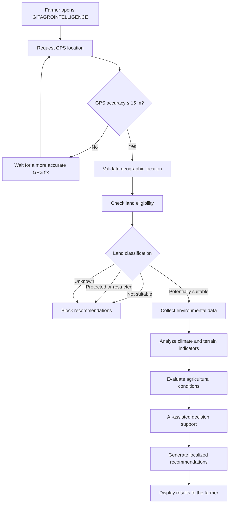

# 🌱 GITAGROINTELLIGENCE
### AI-Powered Agricultural Decision Support for Smallholder Farmers in South Kivu, DRC

**Turning Earth observation data into practical agricultural decisions.**

## 1. Project Overview

GITAGROINTELLIGENCE is an AI-powered agricultural decision-support platform designed to help smallholder farmers make better farming decisions in South Kivu, Democratic Republic of the Congo (DRC).

The project focuses on the agricultural challenges faced by farming communities in Kabare, Walungu, Kalehe, and the surrounding areas of Bukavu.

Many smallholder farmers work on small plots of land, often located on steep slopes and exposed to soil degradation, erosion, changing rainfall patterns, and declining soil fertility. They also face limited access to agricultural information, technical advice, and reliable market opportunities.

GITAGROINTELLIGENCE aims to transform environmental and agricultural data into understandable, localized, and actionable recommendations.

## 2. The Problem

Smallholder farmers in South Kivu face several interconnected challenges:

- Soil degradation and declining soil fertility.
- Soil erosion, particularly on steep slopes.
- Irregular rainfall and changing temperature conditions.
- Limited access to localized agricultural information.
- Difficulty selecting suitable crops for specific locations.
- Limited financial resources for agricultural inputs.
- Uncertainty about crop profitability and market conditions.

General agricultural recommendations are often insufficient because they do not account for the specific environmental conditions of each farming location.

## 3. Our Solution

GITAGROINTELLIGENCE combines geolocation, Earth observation data, environmental indicators, agricultural knowledge, and AI-assisted decision support.

The platform analyzes the user's farming location and relevant environmental conditions to help identify potentially suitable crops and provide practical recommendations.

Its main objectives are to:

- Support location-based crop selection.
- Help farmers understand local climate conditions.
- Identify environmental constraints that may affect agricultural production.
- Encourage sustainable soil management practices.
- Provide accessible agricultural guidance adapted to smallholder farming conditions.

## 4. How It Works — Project Workflow

The platform follows a structured decision-making process.

### Step 1 — GPS Geolocation

The user activates location detection on a GPS-enabled device.

The application waits until the device reports an accuracy of **15 meters or better**.

- Accuracy ≤ 15 m: location accepted.
- Accuracy > 15 m: the application continues waiting for a better GPS fix.

The application uses the device's reported GPS accuracy and does not artificially improve or fabricate location precision.

### Step 2 — Land Eligibility Screening

Before generating crop recommendations, the system checks whether the selected location is potentially suitable for agricultural analysis.

It considers available geographic information to identify possible restrictions, such as:

- Buildings and infrastructure.
- Roads and other non-agricultural areas.
- Urban and industrial land uses.
- Protected areas and conservation zones.

The system classifies the result as:

- **NOT SUITABLE:** a known non-agricultural feature intersects the selected location.
- **PROTECTED / RESTRICTED:** the location may fall within a protected or restricted area.
- **POTENTIALLY SUITABLE:** no known restriction has been identified in the available data.
- **UNKNOWN:** available geographic information is insufficient or conflicting.

Crop recommendations are not generated when the location is classified as unsuitable, protected/restricted, or unknown.

This screening is preliminary. It does not establish land ownership, legal authorization, or definitive agricultural suitability.

### Step 3 — Environmental and Climate Data Collection

The system gathers relevant environmental indicators associated with the selected location.

Depending on the available integrations, these may include:

- Precipitation.
- Maximum temperature.
- Elevation.
- Terrain characteristics.
- Vegetation indicators.
- Historical climate patterns.

These indicators help characterize the environmental conditions that influence agricultural decisions.

### Step 4 — Agricultural Analysis

The platform combines environmental indicators with agricultural knowledge and crop requirements.

The analysis considers factors such as:

- Climate suitability.
- Elevation and terrain.
- Soil-related indicators, where available.
- Crop requirements.
- Erosion risks.
- Seasonal conditions.
- Sustainable agricultural practices.

### Step 5 — AI-Assisted Recommendations

The system transforms the analysis into understandable recommendations.

Possible outputs include:

- Potentially suitable crops.
- Agricultural practices adapted to local conditions.
- Crop rotation suggestions.
- Intercropping opportunities.
- Soil-cover and erosion-control practices.
- Recommendations for more sustainable land management.

Recommendations are intended as decision support, not as a replacement for local agronomic expertise or field-based soil testing.

### Step 6 — Results and Decision Support

The user receives information adapted to the selected location.

The goal is to make environmental data easier to understand and more useful for everyday agricultural decisions.

## 5. Workflow Diagram

## 6. Data Sources and Technologies

GITAGROINTELLIGENCE is designed to combine Earth observation, environmental information, agricultural statistics, and software technologies.

The following sources should be listed as active project integrations only when they are actually connected and used in the current codebase.

| Source / Technology | Purpose |
|---|---|
| NASA POWER | Climate indicators, including precipitation and temperature |
| TerraClimate | Historical climate information |
| MODIS | Vegetation monitoring indicators, where integrated |
| FAOSTAT | Agricultural statistics and reference information |
| Open-Meteo Elevation API | Elevation information, where integrated |
| OpenStreetMap | Geographic features and land-use screening |
| Protected Planet | Protected-area information, where integrated |
| Python | Data processing and analytical components |
| JavaScript | Interactive application functionality |
| HTML / CSS | User interface |
| GitHub | Source-code management and collaboration |
| Google AI Studio / Gemini | AI-assisted development or analysis, where integrated |

### Important Data Considerations

- Historical climate data does not represent real-time weather forecasts.
- Vegetation indices do not directly measure soil fertility.
- National agricultural statistics should not automatically be interpreted as smallholder farm yields.
- Geographic datasets may be incomplete or outdated.
- Field measurements and local validation remain important.

## 7. Sustainable Agriculture Approach

GITAGROINTELLIGENCE promotes agricultural practices that can help protect soil resources and improve long-term farm resilience.

Examples include:

**Intercropping:** Combining cereals and legumes, such as maize and beans, where locally appropriate.

**Crop rotation:** Alternating nutrient-demanding crops with legumes to support more sustainable nutrient management.

**Soil cover:** Encouraging practices that maintain vegetation cover and reduce exposure of soil to rainfall and erosion.

**Slope-aware farming:** Considering terrain characteristics when evaluating agricultural practices.

**Context-based crop selection:** Taking account of altitude, climate, environmental constraints, and local farming conditions.

These practices are recommendations to be adapted to local agronomic conditions.

## 8. Expected Impact

GITAGROINTELLIGENCE aims to:

- Improve access to localized agricultural information.
- Support better-informed crop selection.
- Promote sustainable soil management.
- Increase awareness of erosion risks.
- Help farmers make more informed decisions under climate uncertainty.
- Support agricultural resilience in mountainous rural communities.
- Demonstrate how Earth observation data can be translated into practical local benefits.

The project is particularly focused on smallholder farmers in South Kivu, where access to precise and accessible agricultural information remains a challenge.

## 9. Limitations and Future Development

The platform is a decision-support prototype and does not replace professional agronomic assessment.

Its recommendations depend on the quality, resolution, availability, and timeliness of the underlying data.

Future improvements may include:

- Field validation with local farmers and agricultural experts.
- More detailed soil measurements.
- Improved local crop-yield and farm-gate price datasets.
- Better seasonal climate-risk analysis.
- Integration of additional verified geographic datasets.
- Evaluation of recommendation accuracy under real farming conditions.

## 10. Project Mission

Our mission is to make Earth observation and artificial intelligence more accessible to smallholder farmers.

By connecting environmental data with local agricultural realities, GITAGROINTELLIGENCE seeks to turn complex information into practical decisions that support more resilient and sustainable agriculture in South Kivu.

**From satellite data to local agricultural decisions.**

**Built for smallholder farmers. Inspired by local challenges. Powered by data and innovation.**
